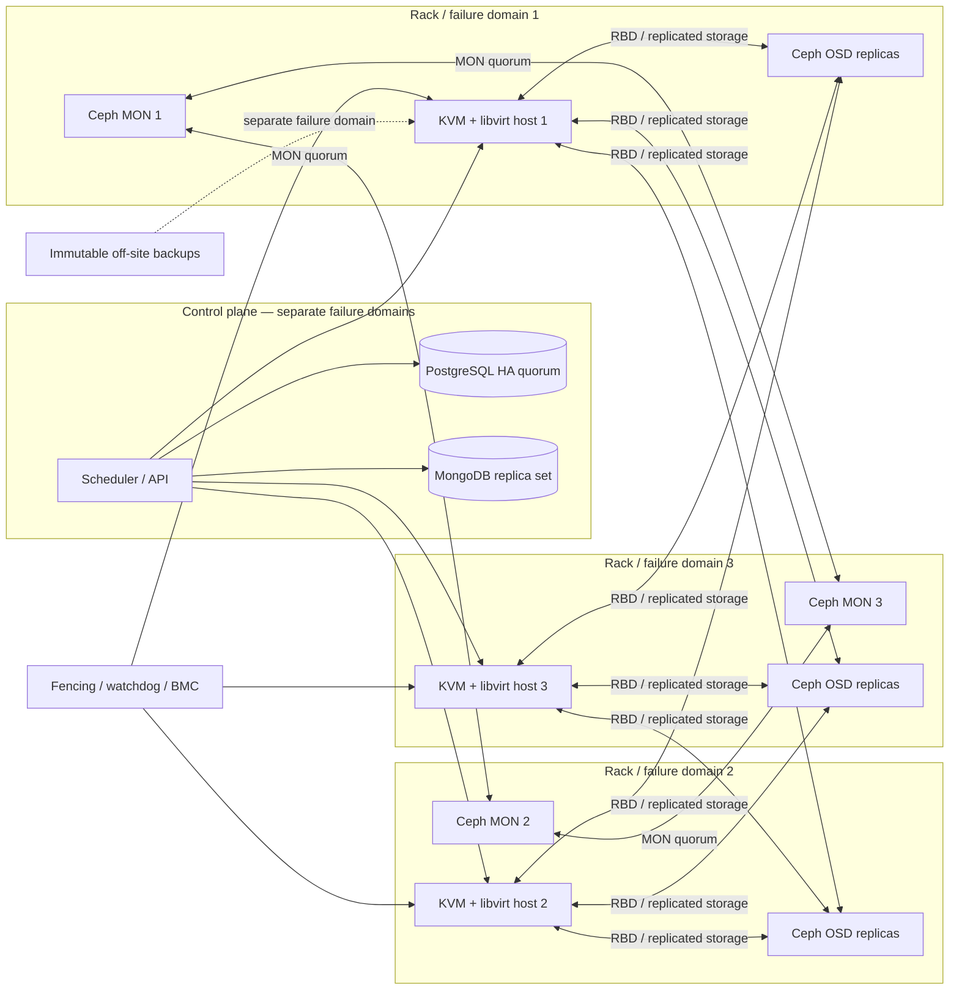

# HA architecture proposal

## Proposed design

Use a minimum of **three independent racks / failure domains** with Ceph RBD for VM disks, and a separate three-member control/quorum plane. Each compute node runs Debian, KVM and libvirt; the management plane schedules guests only after quorum and fencing checks. The editable source is `architecture.mmd`; the Mermaid diagram is rendered below.

- Ceph: 3 MONs across distinct failure domains; OSD replicas placed across racks (`size=3`, `min_size=2`, `failure_domain=rack`) for VM pools. Acknowledge writes only under the configured quorum policy. Keep recovery/backfill throttled and reserve capacity.
- Compute: at least 3 KVM hosts per cluster, with spare N+1 CPU/RAM capacity. Use a cluster manager/orchestrator for placement and controlled restart; do not let independent hosts start the same guest disk.
- Fencing: use hardware watchdog plus BMC/IPMI STONITH (or equivalent). A host is fenced before a replacement starts a guest whose previous owner may still be alive. Corosync quorum alone does not prove the old host is off.
- Networks: separate management/control, storage replication, and tenant/VM traffic. Redundant NICs and switches; monitor path health and MTU end-to-end.
- Control plane: PostgreSQL HA with a consensus/fencing-aware manager; MongoDB replica set across failure domains. Protect control-plane state and credentials separately from the hypervisor cluster.

## Targets (assumptions to validate with product owners)

- **Host failure with shared replicated Ceph RBD:** target RPO 0 for acknowledged guest writes under a healthy quorum and a single failure-domain loss; target RTO ≤5 minutes for eligible guests after fencing and scheduler decision. These are design targets, not test results. Loss of quorum, multiple failures, or a defective client/filesystem can violate them.
- **Region/site loss:** target RPO ≤15 minutes and RTO ≤60 minutes only if a separately operated asynchronous DR site and tested runbooks exist. This is not provided by synchronous in-cluster replication.
- **Local-NVMe-only hosts:** no transparent host failover guarantee. RPO/RTO depend on the last valid backup/replica and restore capacity; do not claim zero RPO.

## Split brain, quorum and failure behavior

1. Use an odd MON quorum (3 or 5) and keep monitors in distinct failure domains.
2. Use cluster quorum plus fencing before guest restart; on loss of quorum, prefer stopping placement changes over dual ownership.
3. Ceph RBD exclusive-lock/blocklist behavior must be enabled and tested with the chosen libvirt/QEMU stack.
4. A network partition is not proof of host death. Confirm BMC power state or fence the node before starting guests elsewhere.
5. Test a lost rack, a lost MON, a compute host crash, and a storage path failure separately in a non-production environment.

## Replication, backup and capacity

Replication improves availability; it copies deletes, corruption and ransomware. It is **not a backup**. Keep immutable/offline backups in a separate security and failure domain, with periodic restore drills and application-consistent database backups.

With 3 replicas, raw capacity overhead is roughly 3× before metadata, snapshots, recovery headroom and operational reserve; plan to keep utilization below ~70–75% and include N+1 OSD/node capacity. Rebuilds consume network and NVMe bandwidth and can raise guest latency; throttle them against customer SLOs. Thin provisioning does not remove the need for physical free-space alerts.

## Maintenance

- Drain one compute host at a time; confirm live-migration/storage health and enough spare capacity before evacuating.
- Never take down two quorum members or a majority of a failure domain simultaneously.
- Check Ceph health, PG state, recovery/backfill, capacity and VM SLOs before and after each step.
- Patch one failure domain at a time, wait for full recovery, and keep a tested rollback plan.
- Back up cluster configuration, control-plane databases and key material independently.

## Lab limits

The connected Debian 11.7 VM has 4 vCPU, 3.8 GiB RAM and a 19 GiB root disk. Nested KVM is exposed, but this is one VMware guest with no independent racks, storage nodes, BMC, or separate monitor quorum. The HA proposal is therefore documented, not claimed as a deployed or fault-injection-tested cluster.

## Architecture diagram

